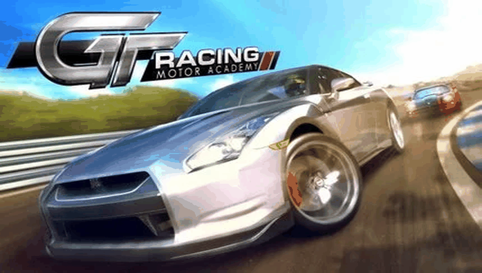

# GT RACING: MOTOR ACADEMY HD — PS Vita Port

<p align="center">
  
</p>

<p align="center">
  <b>Native port of GT Racing: Motor Academy HD (Gameloft) for PlayStation Vita and PlayStation TV.</b>
</p>

<p align="center">
  
  
  
  
  
</p>

---

## 📖 Description

**GT Racing: Motor Academy HD** is Gameloft's acclaimed realistic racing simulator, featuring over 100 licensed cars from manufacturers worldwide and authentic circuit physics. Originally released for Android as version **3.2.8** (`com.gameloft.android.TBFV.GloftGTHP.ML`).

This port runs the compiled native ARM library (`libGTRacing.so`) from the Android release directly on the PS Vita's ARM Cortex-A9 processor, using a custom dynamic loader (*soloader*) and an Android environment emulation layer (*FalsoJNI*), with [vitaGL](https://github.com/Rinnegatamante/vitaGL) providing hardware-accelerated GLES 1.1 rendering.

### 🎮 Current Status: Playable (Beta)

The game **is fully playable from career licenses and arcade races to championship events**. Extensive work has gone into reverse engineering the native engine, implementing full physical gamepad controls, native audio playback, and software video decoding.

Since this is a **Beta release**, keep in mind:
* **Audio:** Fully working with multi-channel sound effects and music, but minor pitch quirks or looping inconsistencies might occasionally occur on certain engine sounds.
* **Game Speed / Performance:** In heavy tracks or races with many competitor cars on screen, the framerate may dip slightly due to CPU and physics load.
* **Controls Scheme:** You **must select the second control option (Touch Controls / Controles Táctiles)** in the in-game options menu for physical buttons to map properly.

---

### ✨ What Works

- **Native ARM Execution**: `libGTRacing.so` runs natively on the Vita's CPU without any emulation of the game logic code.
- **Full JNI Lifecycle Bootstrap**: Matches the official Android lifecycle order (`nativeGetJNIEnv` → `GLResLoader.init` → `GLMediaPlayer.init` → `GTRacing.nativeInit` → `GameRenderer.nativeInit` → `GameRenderer.nativeResize`).
- **vitaGL Graphics Pipeline**: Hardware-accelerated GLES 1.1 fixed-function rendering across the full native 960x544 PlayStation Vita widescreen display.
- **Native Audio Subsystem**: Multi-channel 48kHz audio mixer via `sceAudioOut`, decoding OGG and WAV sound effects and music tracks with `stb_vorbis` and `minimp3`.
- **Full Physical Controls**: Analog stick and D-Pad steering, L/Square braking, R/Cross acceleration, Start pause, Circle back/auto-save.
- **HUD Toggle (Triangle)**: On-screen touch buttons (arrows, pedals, steering wheel) start hidden for a clean console aesthetic and can be toggled on/off anytime with **Triangle**.
- **Intro Video Playback**: Fullscreen software playback of the original MPEG-4 intro movie (`gtracing.mp4` / `gtracing.m4v`) at native 800x480 resolution without letterbox flicker, skippable with **Cross**, **Circle**, or **Start**.
- **Robust Save & Back Navigation**: Pressing **Circle** in menus triggers an automatic profile save (`Profile.0.gts`) and navigates back cleanly.

---

### 🕹️ Controls

> ⚠️ **IMPORTANT**: In the game's options menu (**Options → Controls**), you **MUST select the second control scheme: Touch Controls (Controles Táctiles)**. Physical buttons map directly to the on-screen pedals and steering interfaces of this mode.

| Vita Input | Action |
|---|---|
| **Left Analog Stick** / **D-Pad Left/Right** | Steer Left / Right |
| **R Trigger** / **Cross (❌)** / **D-Pad Up** | Accelerate |
| **L Trigger** / **Square (🟥)** / **D-Pad Down** | Brake / Reverse |
| **Triangle (▲)** | Toggle HUD Touch Buttons on/off |
| **Start** | Pause / In-Game Menu |
| **Circle (⭕)** | Back / Save Profile (in menus) |
| **Touchscreen** | Multi-touch interactive UI / Menu selection |

---

### ⚠️ Known Issues

- **Game Speed / Framerate Dips:** On tracks with dense scenery or large grids of opponent cars, the framerate may drop below 30 FPS.
- **Audio Quirks:** Some vehicle engine loops might experience minor pitch stepping or slight volume variations during rapid deceleration.
- **Control Scheme Selection:** Using accelerometer tilt mode is not supported by physical buttons; always ensure the second control option (**Touch Controls**) is selected.

---

## 📋 Prerequisites

To run this port on your PS Vita or PS TV, you will need:

1. A PS Vita or PS TV running Custom Firmware (**HENkaku** or **Enso**), firmware 3.60 or 3.65 recommended.
2. [**kubridge**](https://github.com/TheOfficialFloW/kubridge/releases) and [**FdFix**](https://github.com/TheOfficialFloW/FdFix/releases) installed in `ur0:tai/config.txt` under `*KERNEL`.
3. [**libshacccg.suprx**](https://github.com/Rinnegatamante/ShaRKBR33D/releases/latest) installed in `ur0:data/`.
4. A legally obtained copy of **GT Racing: Motor Academy HD v3.2.8** for Android (`com.gameloft.android.TBFV.GloftGTHP.ML`).

---

## 📦 Installation Instructions

1. Install `gtracingmotoracademyhd.vpk` on your PS Vita using **VitaShell**.
2. Obtain the Android game files for **GT Racing: Motor Academy HD v3.2.8** (`.apk` and its data cache).
3. Open the `.apk` as a ZIP archive and extract `lib/armeabi/libGTRacing.so` to your PC.
4. Copy `libGTRacing.so` to `ux0:data/gtracingmotoracademyhd/` on your Vita.
5. Copy the game data folder `GTRacing/` (containing `gtracing.mp4`, `.ba4`, `.ba5`, `.ogg` audio files, etc.) into `ux0:data/gtracingmotoracademyhd/`.
6. Launch the game from your LiveArea!

### Final File Structure in `ux0:data/gtracingmotoracademyhd/`

```text
ux0:data/gtracingmotoracademyhd/
├── libGTRacing.so             <- Native library from lib/armeabi/
├── GTRacing/                  <- Game data folder
│   ├── gtracing.mp4           <- Intro video
│   ├── *.ogg / *.wav          <- Audio files
│   ├── *.ba4, *.ba5, etc.     <- Game archives and textures
│   ├── LoadingMenu.swf        <- Flash UI menus
│   └── ...
└── logs/                      <- Debug logs (log_001.log ...)
```

---

## 🛠️ Building from Source

### Build Prerequisites

- [VitaSDK](https://vitasdk.org/) with softfp toolchain.
- Vita portlibs: `vitaGL`, `vitashark`, `kubridge`, `pthread`, `ffmpeg` (`avformat`, `avcodec`, `avutil`, `swresample`, `mp3lame`).
- CMake and Make.

### Build Steps

```bash
mkdir build && cd build
cmake ..
make -j4
```

This generates `eboot.bin` and `gtracingmotoracademyhd.vpk`.

---

## 🏗️ Project Structure

- `source/`: Native C/C++ loader (lifecycle, GLES rendering, audio mixer, input router, video decoder).
- `lib/`: Auxiliary libraries (`so_util`, `falso_jni`, `libc_bridge`, `fios`, `vitagl`).
- `extras/`: LiveArea assets (`icon0.png`, `bg0.png`, `pic0.png`, `startup.png`, `template.xml`).
- `PORTING_PLAN.md`: Technical documentation, reverse engineering notes, and export mappings.
- `port_progress.md`: Phase-by-phase development and bug diagnosis log.

---

## ⚖️ Disclaimer

**GT Racing: Motor Academy** is a registered trademark of Gameloft. This project is an unofficial port and is not affiliated with, endorsed by, or produced by Gameloft.

This repository does **not** contain any copyrighted game assets, proprietary binaries, or media files. Users must provide their own legally acquired copy of the original Android release to play the game on PS Vita.

---

## 👥 Credits and Acknowledgements

- **Gameloft**: Original developers of GT Racing: Motor Academy HD.
- **TheFloW**: For `so_util`, `kubridge`, `FdFix`, and foundational Android soloader techniques.
- **Rinnegatamante**: For `vitaGL` and invaluable contributions to the PS Vita homebrew ecosystem.
- **v-atamanenko**: For `FalsoJNI` and soloader boilerplate architecture.
- **Vita Community**: For continuous support, testing, and feedback.

---

## License

This software is distributed under the terms of the MIT License. See [LICENSE](LICENSE) for details.
